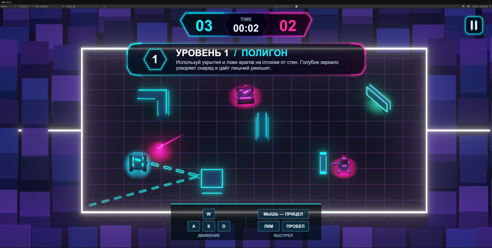
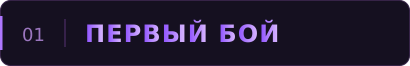
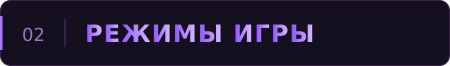
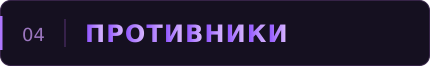
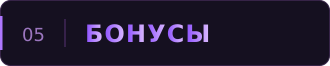
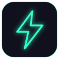
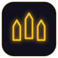
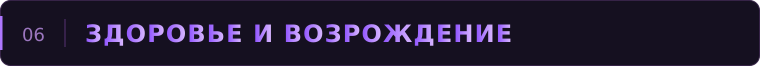

  

  
  
  

Одиночный танковый экшен с видом сверху, неоновыми аренами и боями, в которых стены становятся частью оружия. Управляйте манёвренным танком, уклоняйтесь от снарядов и поражайте противников рикошетом из-за укрытий.

> Для полного погружения играйте в полноэкранном режиме и включите звук.

  

## 

1. Нажмите **«Играть»**, чтобы начать кампанию.
2. Освойте движение и наведите орудие на противника. Бирюзовая пунктирная линия поможет выбрать направление выстрела.
3. Используйте стены и зеркала, чтобы атаковать из-за укрытия, и следите за возвращающимися снарядами.
4. Уничтожьте всех врагов на арене, чтобы перейти к следующему уровню. Если жизни закончатся, начните попытку заново.

## 

| Кампания | Бесконечный бой |
|---|---|
| **Пять уровней** с меняющимися боевыми ситуациями. | **Отдельная арена** на выживание. |
| Уничтожьте всех противников и сохраните хотя бы одну жизнь. | Продержитесь как можно дольше и уничтожьте как можно больше врагов. |
| Количество жизней зависит от уровня. | У вас три жизни, а уничтоженные противники возвращаются в бой. |

  

## 

### Клавиатура и мышь

| Действие | Управление |
|---|---|
| Движение | <kbd>W</kbd> <kbd>A</kbd> <kbd>S</kbd> <kbd>D</kbd> или стрелки |
| Прицеливание | Мышь |
| Выстрел | Левая кнопка мыши или <kbd>Пробел</kbd> |
| Непрерывная стрельба | Удерживайте кнопку выстрела — танк стреляет по мере перезарядки |
| Пауза / продолжение боя | <kbd>Esc</kbd> или <kbd>P</kbd> |
| Повторить попытку | <kbd>R</kbd> в меню паузы или на экране результата |
| Следующий уровень | <kbd>Enter</kbd> на экране победы; после финала — начало кампании заново |

### Телефон

Играйте в **горизонтальном положении**.

| Левый джойстик | Правый джойстик |
|---|---|
| Движение танка | Направление орудия |

## 

| Подвижные танки | Турели |
|---|---|
| Перемещаются по арене, ищут возможность для атаки и заставляют постоянно менять позицию. | Остаются на месте и контролируют проходы. |

## 

Чтобы подобрать бонус, подъедьте к нему. Бонусы встречаются на аренах, а на некоторых уровнях могут появляться после уничтожения противников.

| | Бонус | Эффект |
|:---:|---|---|
|  | **Ремонт** | Восстанавливает одну единицу здоровья, не превышая максимальный запас. |
|  | **Щит** | Поглощает следующее попадание. Можно накопить защиту от двух попаданий. |
|  | **Ускорение** | На шесть секунд повышает скорость движения — удобно для обхода врага и выхода из-под огня. |
|  | **Усиленная стрельба** | На шесть секунд сокращает перезарядку и заменяет одиночный выстрел тройным залпом. |

Ускорение и усиленная стрельба прекращаются при гибели танка. Подбирайте их, когда готовы использовать преимущество: время действия идёт сразу после подбора.

## 

Индикатор над танком показывает его оставшееся здоровье. Попадания уменьшают этот запас; когда он заканчивается, танк уничтожается.

Игровой интерфейс показывает оставшиеся жизни, число врагов и время прохождения. В бесконечном бою вместо числа оставшихся врагов отображается количество уничтоженных противников.

  
   

